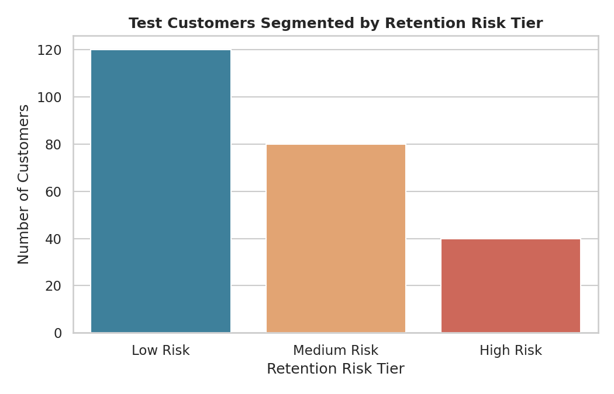
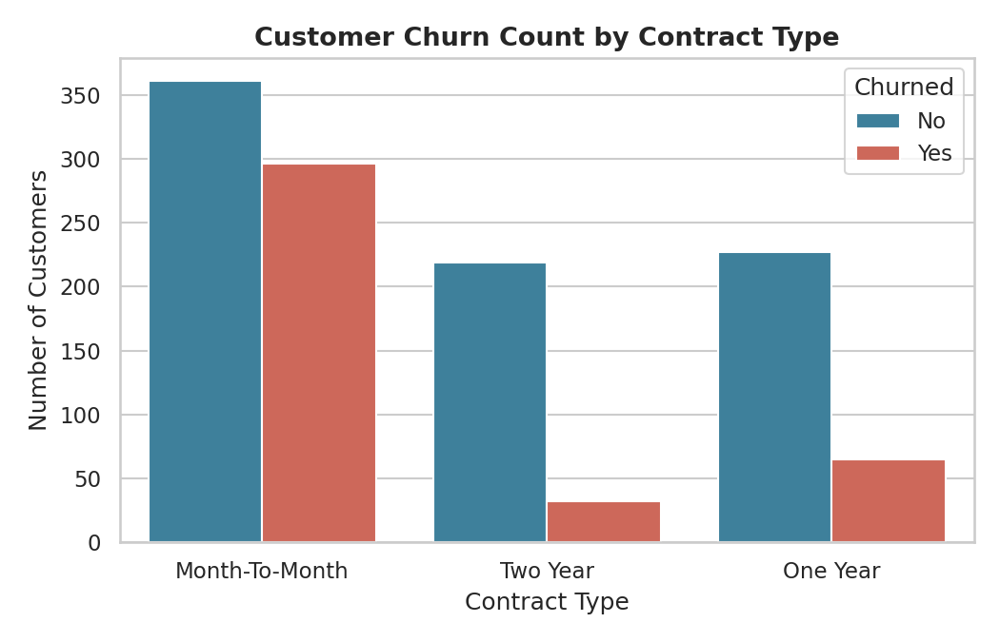
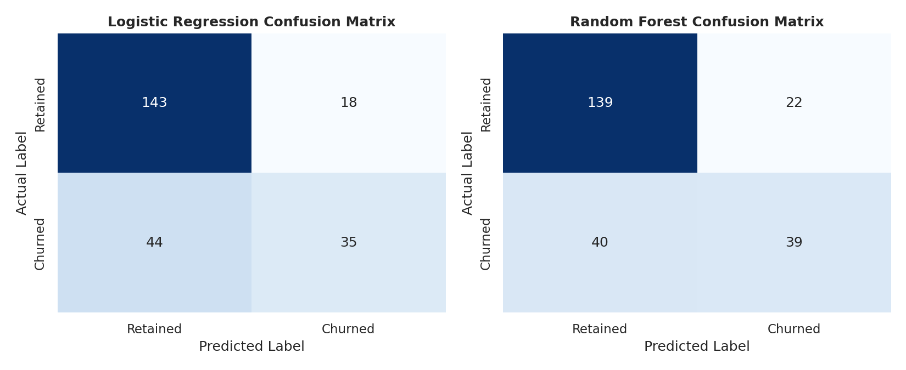
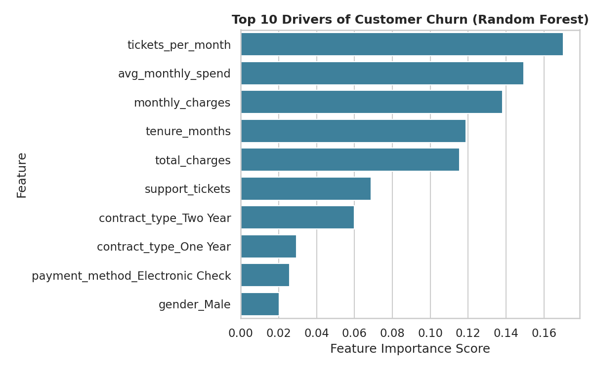

# Customer Churn & Retention Risk Prediction (Machine Learning)


An end-to-end Machine Learning classification pipeline built in **Python** to predict subscription customer churn, uncover key behavioral attrition drivers, and segment customers into actionable **Low, Medium, and High Retention Risk** tiers.



---

## Executive Summary & Business Impact

Winning a new subscriber costs significantly more than retaining an existing one. This project transforms raw customer billing, contract, and support logs into a prioritized retention call list so customer success teams can intervene before high-risk accounts cancel.

| Risk Tier | Probability Threshold | Test Customers | Avg Churn Probability | Monthly Revenue at Risk | Recommended Action |
| :--- | :--- | :--- | :--- | :--- | :--- |
| **High Risk** | `> 0.60` | **40** (`16.7%`) | **67.0%** | **$3,557.49** (`$42.69K/yr`) | Priority Retention Call + Annual Plan Discount |
| **Medium Risk** | `0.30 – 0.60` | **80** (`33.3%`) | **44.0%** | **$6,426.25** | Proactive Check-In & Tech Support Offer |
| **Low Risk** | `< 0.30` | **120** (`50.0%`) | **18.0%** | **$7,203.26** | Standard Loyalty Newsletter |

### Key Analytical Findings
* **Contract Lock-In Drives Retention:** Customers on flexible **Month-to-Month** plans churned at **45.05%**, compared to **22.26%** for **One-Year** and **12.75%** for **Two-Year** contracts.
* **Support Friction Is the #1 Predictor:** Engineered feature **`tickets_per_month`** ranked as the single strongest predictor of churn (`0.170` importance), ahead of raw monthly charges (`0.138`) and tenure (`0.119`).
* **Early-Tenure Vulnerability:** Churned customers averaged shorter tenures (**29.32** vs. **39.42** months), higher monthly bills (**$78.20** vs. **$64.96**), and more support complaints (**2.54** vs. **1.79**).



---

## Data Pipeline & Feature Engineering

### 1. Data Cleaning & Validation (`1,208` → `1,200` Records)
* **Deduplication:** Removed `8` duplicate customer records based on `customer_id`.
* **Standardization:** Unified inconsistent text labels in `contract_type` (`month-to-month` → `Month-To-Month`).
* **Type Conversion & Imputation:** Converted text-formatted `total_charges` to numeric (`float64`), imputed missing `monthly_charges` with the median, derived missing `total_charges` via `monthly_charges * tenure_months`, and filled missing `internet_service` entries using the mode.

### 2. Behavioral Feature Engineering & Encoding
* **`tickets_per_month`:** Measures support complaint frequency relative to customer tenure (`support_tickets / tenure_months`).
* **`avg_monthly_spend`:** Captures historical average billing per active month (`total_charges / tenure_months`).
* **`is_new_customer`:** Binary flag identifying subscribers within their first 6 months (`tenure_months <= 6`).
* **Preprocessing:** Applied One-Hot Encoding (`drop_first=True`, producing `18` model features), stratified 80/20 train-test split (`960` train / `240` test), and leak-free `StandardScaler` normalization for Logistic Regression.

---

## Model Evaluation & Diagnostics

| Model | Accuracy | Precision | Recall | F1-Score | ROC-AUC |
| :--- | :--- | :--- | :--- | :--- | :--- |
| **Logistic Regression** (Baseline) | **74.2%** | **0.660** | 0.443 | 0.530 | **0.801** |
| **Random Forest Classifier** (Selected) | **74.2%** | 0.639 | **0.494** | **0.557** | 0.789 |

* **Model Selection:** **Random Forest** (`n_estimators=150`, `max_depth=8`) was selected for risk scoring because it achieved higher **Recall (`0.494`)** and **F1-Score (`0.557`)**, capturing more actual churners (`39` vs. `35` out of `79` churned test accounts) while producing well-calibrated probability tiers.

| Confusion Matrices | Top 10 Churn Drivers |
| :---: | :---: |
|  |  |

---

## Repository Structure

```text
Customer-Churn-Prediction-ML/
├── assets/
│   ├── churn_by_contract.png              # Churn distribution across contract types
│   ├── tenure_and_tickets_vs_churn.png    # Tenure and support ticket comparisons
│   ├── confusion_matrices.png             # Logistic Regression vs. Random Forest matrices
│   ├── feature_importance.png             # Top 10 Random Forest feature importances
│   └── retention_risk_tiers.png           # Test customer segmentation by risk tier
├── data/
│   ├── customer_churn_raw.csv             # Raw customer dataset (1,208 records)
│   ├── customer_churn_cleaned.csv         # Cleaned dataset post preprocessing (1,200 records)
│   └── customer_retention_risk_scores.csv # Prioritized test-set retention call list
├── notebooks/
│   └── Customer_Churn_Prediction.ipynb    # Full step-by-step analysis & modeling notebook
└── README.md
```

---

## How to Run Locally

1. Clone this repository:
   ```bash
   git clone [https://github.com/Sai09110/Customer-Churn-Prediction-ML.git](https://github.com/Sai09110/Customer-Churn-Prediction-ML.git)
   ```
2. Install required Python libraries:
   ```bash
   pip install pandas numpy matplotlib seaborn scikit-learn jupyter
   ```
3. Open `notebooks/Customer_Churn_Prediction.ipynb` in VS Code or Jupyter Notebook and run all cells.

---

## Author

**Harrsha Sai Bathula**  
BS-MS in Computer Science (Data Science & Analytics) | Hyderabad, India  
[](https://www.linkedin.com/in/harrsha-sai-b8258334b)